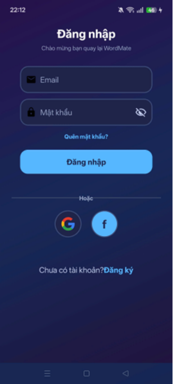
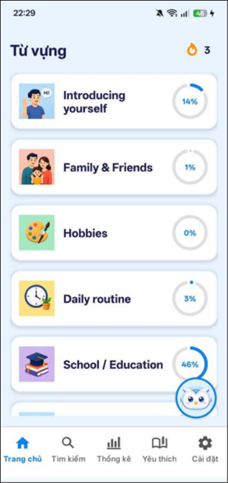
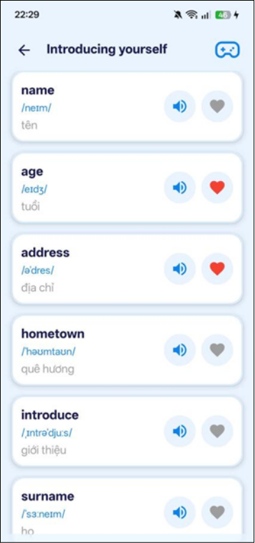
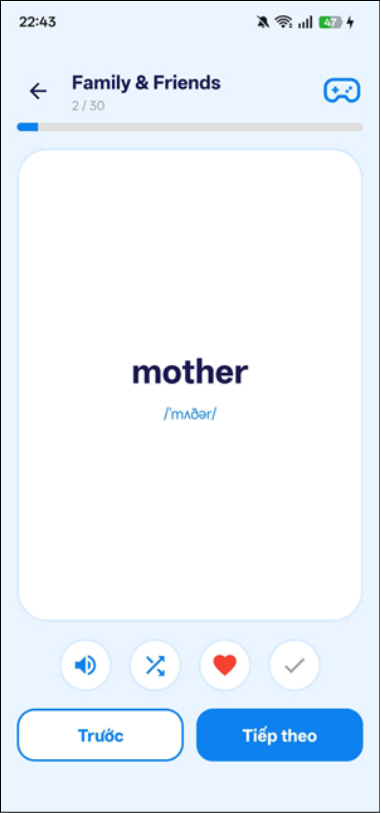
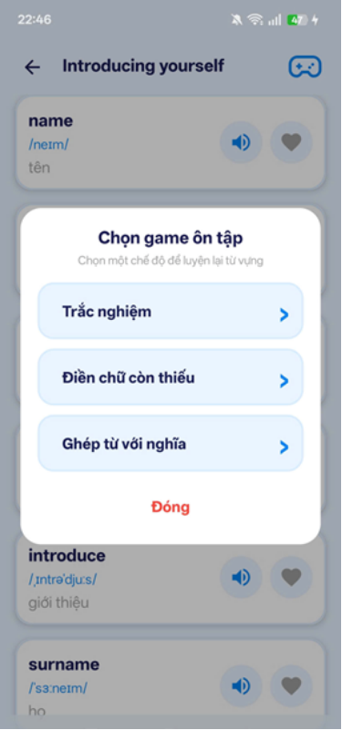
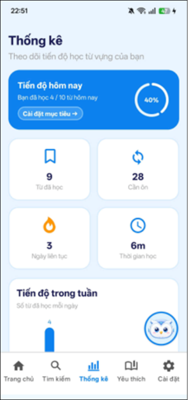
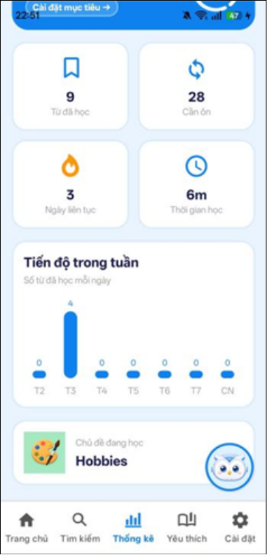

# WordMate - English Vocabulary Learning App

WordMate is an Android application designed to help users learn and improve their English vocabulary through interactive learning methods.

The application combines topic-based vocabulary lessons, flashcards, vocabulary games, dictionary search, and learning progress tracking in one platform.

WordMate is developed using **Java and XML** for Android, with **Firebase** integration for authentication and user data synchronization.

## Features

- **Topic-based Vocabulary:** Learn English vocabulary organized by topics, including pronunciation, meanings, and example sentences.
- **Interactive Flashcards:** Review vocabulary through flashcards with pronunciation, shuffling, and learning status tracking.
- **Vocabulary Games:** Practice vocabulary using multiple-choice quizzes, missing-letter exercises, and word-matching games.
- **Dictionary Search:** Search for English words, view definitions, and receive word suggestions.
- **Favorite Word Lists:** Save and organize vocabulary into personalized collections for review.
- **Learning Dashboard:** Monitor learned words, study time, daily goals, weekly progress, and learning streaks.
- **Study Reminders:** Receive daily notifications to maintain consistent learning habits.
- **User Authentication:** Register and log in using email/password, Google, or Facebook.
- **Cloud Synchronization:** Synchronize supported learning data using Firebase.
- **Personalization:** Customize application language, sound, notifications, and appearance.

## Tech Stack

| Category | Technologies |
|----------|--------------|
| Platform | Android (Min SDK 24, Target SDK 36) |
| Languages | Java, XML, Kotlin DSL |
| UI | AndroidX, Material Components, RecyclerView, ConstraintLayout |
| Authentication | Firebase Authentication, Google Sign-In, Facebook Login |
| Database | Firebase Realtime Database |
| Networking | Retrofit, Gson |
| APIs | Free Dictionary API, Datamuse API |
| Image Loading | Glide |
| Build Tools | Gradle, Android Gradle Plugin |

## Project Structure

```text
wordmate/
├── app/
│   ├── src/
│   │   └── main/
│   │       ├── java/com/example/engapp/
│   │       │   ├── activities/       # Application screens
│   │       │   ├── fragments/        # Navigation screens
│   │       │   ├── adapters/         # RecyclerView adapters
│   │       │   ├── models/           # Data models
│   │       │   ├── network/          # API services
│   │       │   ├── repositories/     # Data management
│   │       │   ├── receivers/        # Notification receivers
│   │       │   └── utils/            # Utility classes
│   │       ├── assets/
│   │       │   └── vocabulary.json   # Vocabulary dataset
│   │       ├── res/                  # Application resources
│   │       └── AndroidManifest.xml
│   ├── google-services.json
│   └── build.gradle.kts
├── gradle/
├── build.gradle.kts
├── settings.gradle.kts
├── gradlew
└── gradlew.bat
```

## Getting Started

### Prerequisites

Before running the project, make sure you have:

- Android Studio installed
- JDK 17 or a compatible JDK
- Android SDK configured
- Android emulator or physical device running Android 7.0 (API 24) or higher
- Internet connection for API and Firebase features

### 1. Clone the Repository

Clone the project from GitHub:

```bash
git clone https://github.com/thule05/wordmate.git
```

Navigate to the project directory:

```bash
cd wordmate
```

### 2. Open the Project in Android Studio

1. Launch Android Studio.
2. Select **Open**.
3. Navigate to the cloned `wordmate` directory.
4. Wait for Gradle synchronization to complete.
5. Install any missing SDK components if prompted.

### 3. Configure Firebase

WordMate uses Firebase for user authentication and data synchronization.

To configure your own Firebase project:

1. Visit the [Firebase Console](https://console.firebase.google.com/).
2. Create a new Firebase project.
3. Register an Android application with the package name `com.example.engapp`, or update the application ID accordingly.
4. Download the `google-services.json` configuration file.
5. Place the file in the `app/` directory.
6. Enable the required authentication providers in Firebase Authentication.
7. Configure Firebase Realtime Database and its security rules.
8. Configure Google and Facebook authentication credentials if these login methods are required.

**Note:** Firebase authentication and synchronization require valid project configuration and appropriate permissions. Do not commit private credentials or service-account keys.

### 4. Build and Run

**Option 1: Using Android Studio**

1. Connect an Android device or start an emulator.
2. Select the target device.
3. Click **Run** in Android Studio.
4. Wait for the application to build and launch.

**Option 2: Using the Command Line**

For Windows:

```powershell
.\gradlew.bat assembleDebug
```

For macOS/Linux:

```bash
./gradlew assembleDebug
```

After a successful build, the debug APK is typically generated at:

```text
app/build/outputs/apk/debug/app-debug.apk
```

## How to Use

### 1. Explore Vocabulary

- Open the application.
- Browse vocabulary topics on the Home screen.
- Select a topic to view its vocabulary list.
- Explore word meanings, pronunciation, and examples.

### 2. Learn with Flashcards

- Select a vocabulary topic.
- Open the Flashcard learning mode.
- Flip cards to reveal word meanings.
- Listen to word pronunciation.
- Mark words as learned and review them when needed.

### 3. Practice with Vocabulary Games

Choose from the available practice modes:

- **Multiple Choice:** Select the correct answer from multiple options.
- **Missing Letters:** Complete words by filling in missing letters.
- **Word Matching:** Match vocabulary words with their corresponding meanings.

### 4. Search and Save Vocabulary

- Use the Search feature to look up English words.
- View definitions and related information.
- Save important words to favorite collections.
- Access saved vocabulary for later review.

### 5. Track Learning Progress

Open the Dashboard to monitor:

- Total learned vocabulary
- Words requiring review
- Daily learning goals
- Study time
- Weekly learning progress
- Learning streaks

### 6. Customize Settings

Users can configure:

- Application language
- Sound and pronunciation preferences
- Daily study reminders
- Light and dark appearance
- Account settings

## Application Architecture

WordMate organizes its source code into separate components to improve maintainability and code organization.

| Component | Responsibility |
|-----------|----------------|
| Activities | Manage application screens and user interactions |
| Fragments | Handle navigation and reusable UI components |
| Adapters | Display vocabulary lists and other data using RecyclerView |
| Models | Represent vocabulary and application data |
| Repositories | Manage data retrieval, persistence, and synchronization |
| Network | Handle external API requests using Retrofit |
| Receivers | Handle notifications and system events |
| Utils | Provide reusable helper functions |

### Data Sources

WordMate uses the following data sources:

**Local Vocabulary Data**

The application includes a vocabulary dataset stored at:

```text
app/src/main/assets/vocabulary.json
```

**External Dictionary APIs**

- [Free Dictionary API](https://dictionaryapi.dev/) - Provides English word definitions and pronunciation information.
- [Datamuse API](https://www.datamuse.com/api/) - Provides word suggestions and related vocabulary.

**Firebase Services**

- Firebase Authentication for account management.
- Firebase Realtime Database for supported user data synchronization.


<h2>Screenshots</h2>

<h3>Authentication & Learning</h3>

<table align="center">
  <tr>
    <td align="center" width="25%">
      
      <br/>
      <sub><b>Login</b></sub>
    </td>
    <td align="center" width="25%">
      
      <br/>
      <sub><b>Home</b></sub>
    </td>
    <td align="center" width="25%">
      
      <br/>
      <sub><b>Vocabulary</b></sub>
    </td>
    <td align="center" width="25%">
      
      <br/>
      <sub><b>Flashcards</b></sub>
    </td>
  </tr>
</table>

<h3>Practice & Progress</h3>

<table align="center">
  <tr>
    <td align="center" width="33%">
      
      <br/>
      <sub><b>Games</b></sub>
    </td>
    <td align="center" width="33%">
      
      <br/>
      <sub><b>Dashboard</b></sub>
    </td>
    <td align="center" width="33%">
      
      <br/>
      <sub><b>Statistics</b></sub>
    </td>
  </tr>
</table>


## Author
[@thule05](https://github.com/thule05) 

